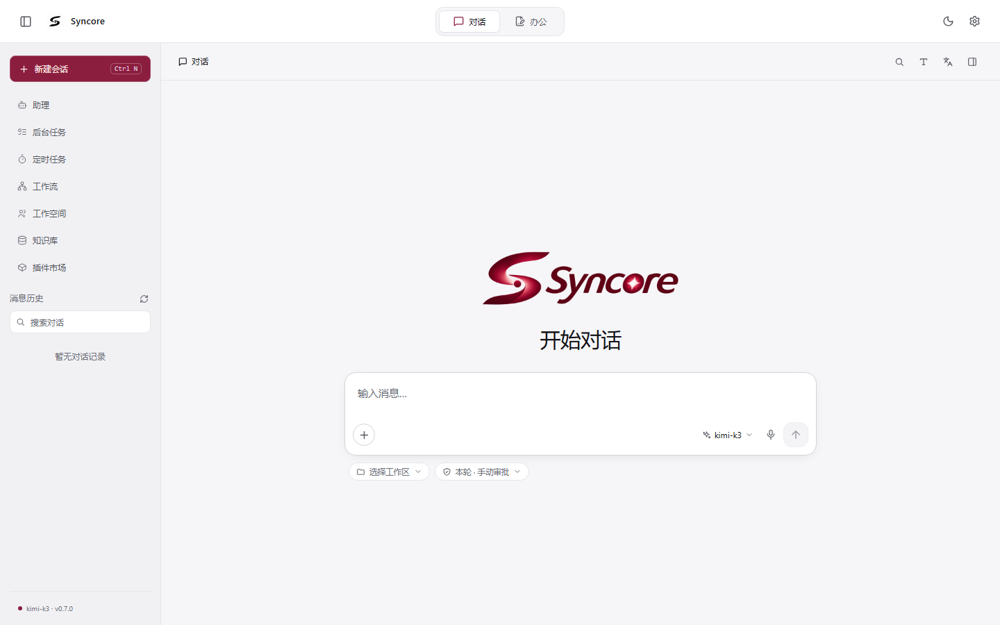
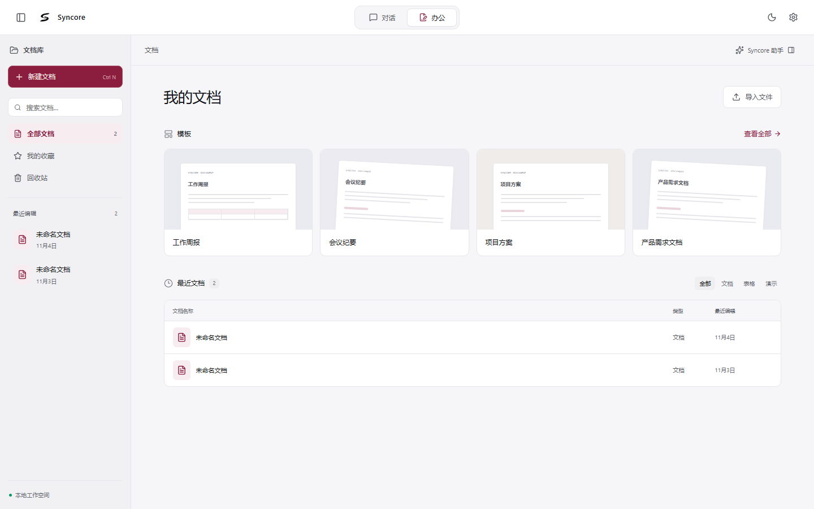
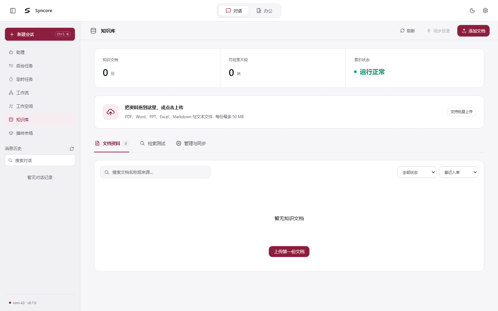
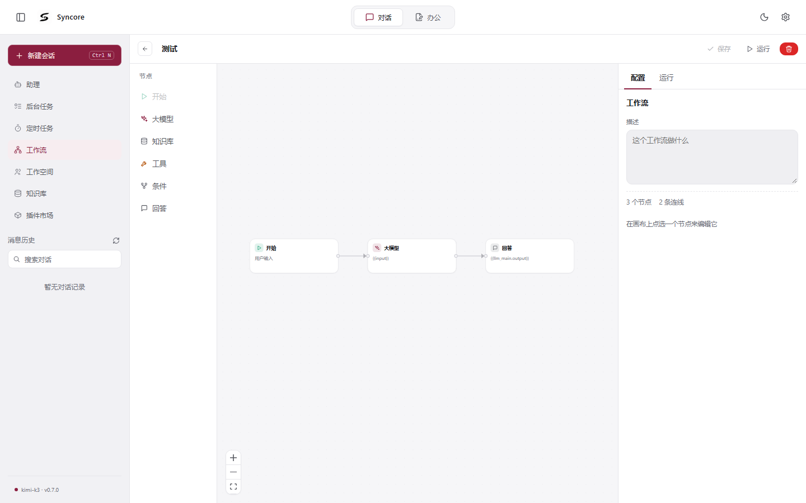
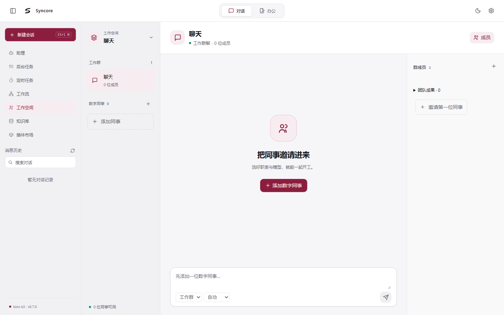
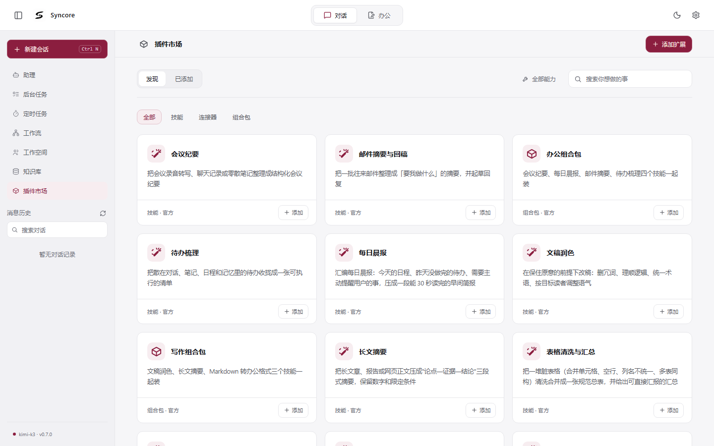

<div align="center">

# Syncore

An enterprise AI workbench: multi-agent collaboration, hybrid-retrieval knowledge base, tasks and approvals, and an extensible skill marketplace — available as a desktop app and a web app.

[![English][badge-en]][readme-en] [![中文][badge-zh]][readme-zh]

![Version v0.7.0][b-version] [![License][b-license]][license] [![Brand assets][b-brand]][brand-license] ![Status Active development][b-status] ![PRs Welcome][b-prs]

![Python][b-python] ![FastAPI][b-fastapi] ![LangChain][b-langchain] ![Pydantic][b-pydantic] ![React][b-react] ![TypeScript][b-ts] ![Vite][b-vite] ![Electron][b-electron] ![Milvus][b-milvus] ![Elasticsearch][b-es] ![Redis][b-redis] ![Neo4j][b-neo4j] ![Docker][b-docker]

*Under active development — internal APIs and directory layout may change.*

</div>

## Preview

<table>
  <tr>
    <td align="center" width="50%"><b>Chat</b><br /></td>
    <td align="center" width="50%"><b>Office</b><br /></td>
  </tr>
  <tr>
    <td align="center"><b>Knowledge base</b><br /></td>
    <td align="center"><b>Workflow editor</b><br /></td>
  </tr>
  <tr>
    <td align="center"><b>Workspace</b><br /></td>
    <td align="center"><b>Skill marketplace</b><br /></td>
  </tr>
</table>

## Features

- **Multi-agent architecture**: LangGraph-based supervisor orchestration with dynamic subgraphs and agent registration
- **Hybrid-retrieval knowledge base**: Milvus vector search + Elasticsearch BM25 keyword search + Neo4j graph relations; optional local embedding / reranking backends
- **Long-conversation context management**: token-budgeted tool-output folding and structured summarization of history
- **Skill system and marketplace**: SKILL.md skill packages, built-in factory skills and an extensible market catalog
- **MCP tool protocol**: connect external MCP tool servers
- **Office documents**: parse docx / xlsx / pptx / pdf / md; generate docx, xlsx, pptx, md, csv, txt and html deliverables
- **Tasks and scheduling**: task lists, scheduled jobs, visual workflow editor (React Flow canvas)
- **Approvals and permissions**: approval gates for sensitive operations, permission management
- **Local voice**: sherpa-onnx local speech recognition (default STT backend) with custom wake words
- **Desktop app**: Electron shell with built-in terminal (node-pty), Live2D desktop pet, packaged installers (portable / NSIS)
- **External channels**: WeChat (iLink gateway) QR login and other channel integrations

## Tech stack

| Layer | Technology |
|---|---|
| Backend | Python 3.11+ · FastAPI · LangChain / LangGraph · Pydantic |
| Frontend | React 18 · TypeScript · Vite · TipTap · React Flow · pixi-live2d-display |
| Desktop | Electron 33 · electron-builder · node-pty |
| Infrastructure | Milvus · Elasticsearch · Redis · Neo4j (Docker) |

## Architecture

```
┌─────────────────┐        ┌─────────────────┐
│    desktop/     │        │    frontend/    │
│  Electron shell │        │  React + Vite   │
│  terminal · pet │        │  chat · KB · ...│
└────────┬────────┘        └────────┬────────┘
         │      HTTP / SSE          │
         └───────────┬──────────────┘
                     ▼
        ┌─────────────────────────┐
        │        backend/         │
        │  FastAPI + LangGraph    │
        │  agents · RAG · skills  │
        └───┬───────┬─────────┬───┘
            │       │         │
      ┌─────▼──┐ ┌──▼───┐ ┌───▼────┐
      │ Milvus │ │  ES  │ │ Redis  │  Neo4j
      │ vector │ │ BM25 │ │ state  │  graph
      └────────┘ └──────┘ └────────┘
```

## Repository layout

```
.
├── backend/                 # FastAPI backend
│   ├── app/                 # application code (agents / api / rag / skills / memory ...)
│   ├── skills/              # built-in factory skills
│   ├── market/              # skill marketplace (catalog.json + skill packs)
│   ├── scripts/             # ops and verification scripts
│   ├── third_party/         # third-party code
│   ├── .env.example         # environment variable template
│   └── pyproject.toml       # dependencies and ruff config
├── brand/                   # single source of all app icons / artwork (proprietary, see BRAND-LICENSE.md)
├── desktop/                 # Electron shell and packaging config
├── frontend/                # React + TypeScript + Vite frontend
├── docs/screenshots/        # UI preview screenshots
├── LICENSE                  # Apache-2.0 (code)
├── BRAND-LICENSE.md         # brand asset license (all rights reserved)
├── README.md / README.en.md # project docs
├── start.ps1 / start.bat    # one-click start (Windows)
└── stop.ps1 / stop.bat      # stop services
```

## Requirements

- **Python** 3.11+
- **Node.js** 18+ (20+ recommended)
- **Docker** (for Milvus / Elasticsearch / Redis / Neo4j)
- OS: the startup scripts currently target Windows (PowerShell); the backend and frontend code themselves are cross-platform

## Quick start

### 1. Start the infrastructure

Start these four services with Docker (container names are up to you; only the ports matter):

| Service | Port | Notes |
|---|---|---|
| Milvus | 19530 | vector search; requires both etcd and Milvus containers, v3.0.x recommended |
| Elasticsearch | 9200 | BM25 keyword search |
| Redis | 6379 | session state and message queues |
| Neo4j | 7687 | graph relations |

### 2. Start the backend

```powershell
cd backend
python -m venv .venv
.\.venv\Scripts\Activate.ps1
pip install -e ".[dev]"
copy .env.example .env        # fill in LLM_API_KEY etc.
python -m uvicorn app.main:app --reload --port 8000
```

Optional extras (install as needed):

- `.[office-read]`: markitdown document parsing
- `.[office-layout]`: docling layout analysis
- `.[local-rerank]` / `.[local-embedding]`: local reranking / embedding (pulls in torch; on Windows, install with the CPU index first: `pip install torch --index-url https://download.pytorch.org/whl/cpu`)

API docs are served at `http://localhost:8000/docs`.

### 3. Start the frontend

```powershell
cd frontend
npm install
npm run dev                    # http://localhost:5173
```

### 4. One-click start

Once the backend environment is ready, from the repository root:

```powershell
.\start.ps1                    # pre-checks Docker, dependencies and ports, then starts backend and frontend in separate windows
.\stop.ps1                     # stops services by port (-Deps also stops Docker containers)
```

### Building the desktop app

```powershell
cd desktop
npm install
npm run dist                   # output goes to desktop/release/ (gitignored)
```

The desktop build bundles the frontend build and the backend into the installer (portable + NSIS), so end users do not need to deploy anything.

## Configuration

Backend configuration lives in `backend/.env`; see `backend/.env.example` for the template. Core settings:

| Variable | Description |
|---|---|
| `LLM_BASE_URL` / `LLM_API_KEY` / `LLM_MODEL` | LLM gateway (OpenAI-compatible; works with Qwen, DeepSeek, Zhipu, OpenAI, etc.) |
| `LLM_TEMPERATURE` / `LLM_TIMEOUT_SECONDS` | sampling and timeout |
| `EMBEDDING_BACKEND` / `RERANK_BACKEND` | embedding / reranking backends, can be switched to `local` |
| `CONTEXT_WINDOW_TOKENS` and related | context budget and compaction strategy (sensible defaults provided) |

Frontend environment variables are in `frontend/.env` (development) and `frontend/.env.desktop` (desktop build). They contain only public API addresses and are safe to commit.

## Offline conversion engine (backend/bin)

The bundled third-party file conversion engine (portable Filee build, ~150MB) is **not in this repository** — it is not distributed via the package index. When redeploying, download the matching version from GitHub Releases and extract it to `backend/bin/` (version mapping is documented in `.env` comments). Existing local `backend/bin/` directories are unaffected.

## Brand assets

`brand/` is the single source of truth for all app icons and artwork. After changing the source images, re-export all icons:

```powershell
cd frontend
pip install Pillow
npm run brand:sync             # regenerates favicon, PWA icons, desktop/build/icon.ico, etc.
```

The exported artifacts (`frontend/public`, `frontend/src/assets/brand`, `desktop/build/icon.ico`) are committed, so a fresh clone can build without running this step.

The brand assets (the `brand/` sources, exported icons and the pet character) are **not covered by the Apache-2.0 code license**; see [BRAND-LICENSE.md](BRAND-LICENSE.md) for usage restrictions.

## Quality checks

```powershell
cd backend && ruff check app    # backend static checks (F + E9)
cd frontend && npm run typecheck
```

## Documentation

- [README.md](README.md): Chinese version
- API docs: served at `http://localhost:8000/docs` once the backend is running

## License

This repository uses a **dual-license** structure:

- **Code**: [Apache License 2.0](LICENSE), Copyright © 2026 Syncore. The implementation code in `backend/`, `frontend/` and `desktop/` may be freely used, modified, redistributed and used commercially, provided the copyright and license notices are retained.
- **Brand assets**: [BRAND-LICENSE.md](BRAND-LICENSE.md) reserves all rights. The `brand/` sources, the exported app icons (favicon, PWA icons, `desktop/build/icon.ico`, etc.) and the pet character (`miss-jiu`) are outside the open-source scope: they may only be distributed unmodified with the software, and may not be modified, reused elsewhere or used to imply official endorsement.

<!-- ============================================================
     Badge & link definitions (reference-style Markdown links,
     invisible once rendered). Edit badges here only.
     Language buttons: 700018 = current language, 9CA3AF = the other one.
     ============================================================ -->

[readme-en]: README.en.md
[readme-zh]: README.md
[license]: LICENSE
[brand-license]: BRAND-LICENSE.md

[badge-en]: https://img.shields.io/badge/English-700018?style=flat-square
[badge-zh]: https://img.shields.io/badge/%E4%B8%AD%E6%96%87-9CA3AF?style=flat-square

[b-version]: https://img.shields.io/badge/Version-v0.7.0-700018?style=flat-square
[b-license]: https://img.shields.io/badge/License-Apache--2.0-4CC3FF?style=flat-square
[b-brand]: https://img.shields.io/badge/Brand-Rights%20Reserved-DFB303?style=flat-square
[b-status]: https://img.shields.io/badge/Status-Active%20Development-4C1?style=flat-square
[b-prs]: https://img.shields.io/badge/PRs-welcome-brightgreen?style=flat-square

[b-python]: https://img.shields.io/badge/Python-3776AB?style=flat-square&logo=python&logoColor=white
[b-fastapi]: https://img.shields.io/badge/FastAPI-009688?style=flat-square&logo=fastapi&logoColor=white
[b-langchain]: https://img.shields.io/badge/LangChain-7FC8FF?style=flat-square&logo=langchain&logoColor=0B2233
[b-pydantic]: https://img.shields.io/badge/Pydantic-E97064?style=flat-square&logo=pydantic&logoColor=white
[b-react]: https://img.shields.io/badge/React-61DAFB?style=flat-square&logo=react&logoColor=20232A
[b-ts]: https://img.shields.io/badge/TypeScript-3178C6?style=flat-square&logo=typescript&logoColor=white
[b-vite]: https://img.shields.io/badge/Vite-9135FF?style=flat-square&logo=vite&logoColor=white
[b-electron]: https://img.shields.io/badge/Electron-47848F?style=flat-square&logo=electron&logoColor=white
[b-milvus]: https://img.shields.io/badge/Milvus-00A1EA?style=flat-square&logo=milvus&logoColor=white
[b-es]: https://img.shields.io/badge/Elasticsearch-005571?style=flat-square&logo=elasticsearch&logoColor=white
[b-redis]: https://img.shields.io/badge/Redis-FF4438?style=flat-square&logo=redis&logoColor=white
[b-neo4j]: https://img.shields.io/badge/Neo4j-4581C3?style=flat-square&logo=neo4j&logoColor=white
[b-docker]: https://img.shields.io/badge/Docker-2496ED?style=flat-square&logo=docker&logoColor=white
