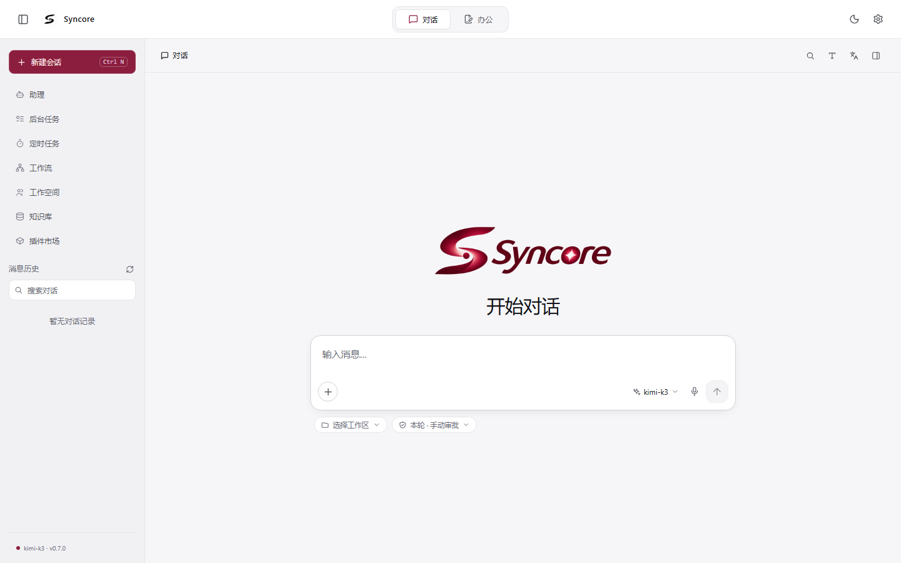
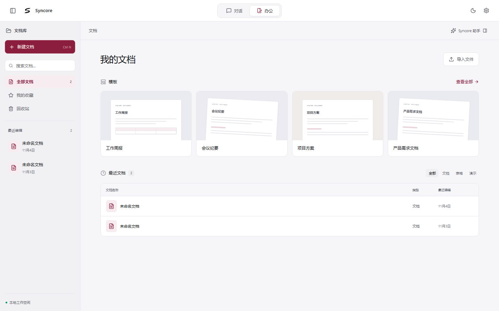
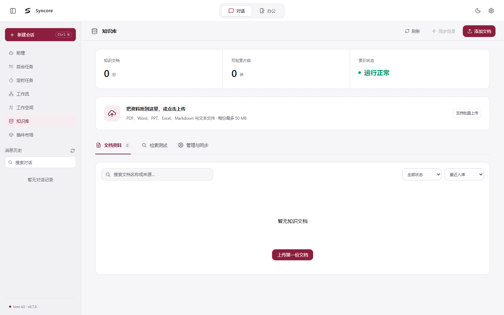
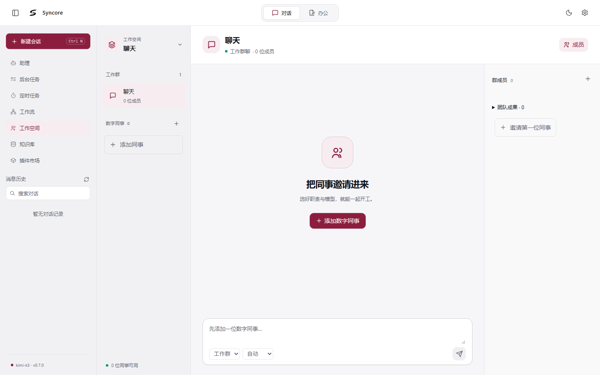
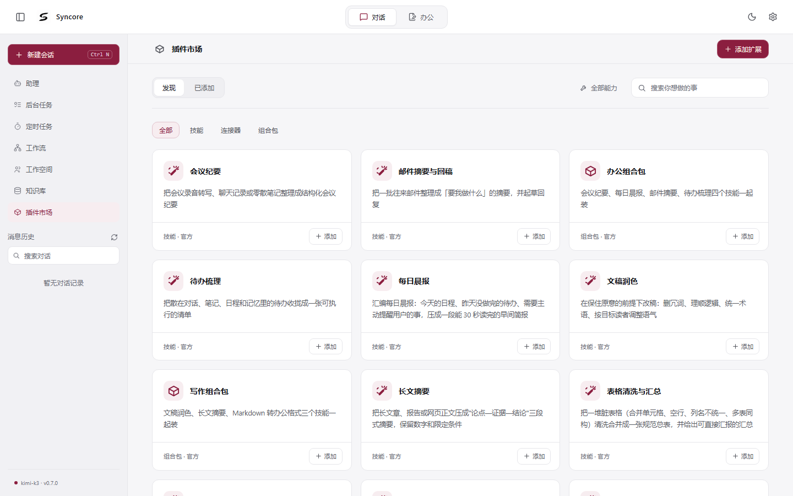

<div align="center">

# Syncore

企业级 AI 工作台：多智能体协作、混合检索知识库、任务与审批、可扩展技能市场，桌面端与 Web 端双形态。

[![中文][badge-zh]][readme-zh] [![English][badge-en]][readme-en]

![版本 v0.7.0][b-version] [![代码许可][b-license]][license] [![品牌资产][b-brand]][brand-license] ![状态 活跃开发][b-status] ![PRs Welcome][b-prs]

![Python][b-python] ![FastAPI][b-fastapi] ![LangChain][b-langchain] ![Pydantic][b-pydantic] ![React][b-react] ![TypeScript][b-ts] ![Vite][b-vite] ![Electron][b-electron] ![Milvus][b-milvus] ![Elasticsearch][b-es] ![Redis][b-redis] ![Neo4j][b-neo4j] ![Docker][b-docker]

*处于活跃开发期，内部接口与目录结构可能变动。*

</div>

## 界面预览

<table>
  <tr>
    <td align="center" width="50%"><b>对话</b><br /></td>
    <td align="center" width="50%"><b>办公空间</b><br /></td>
  </tr>
  <tr>
    <td align="center"><b>知识库</b><br /></td>
    <td align="center"><b>工作空间</b><br /></td>
  </tr>
  <tr>
    <td align="center" colspan="2"><b>技能市场</b><br /></td>
  </tr>
</table>

## 功能特性

- **多智能体架构**：基于 LangGraph 的 supervisor 编排，支持动态子图与智能体注册
- **混合检索知识库**：Milvus 向量检索 + Elasticsearch BM25 关键词检索 + Neo4j 图关联；可选本地 Embedding / 精排后端
- **长对话上下文管理**：按 token 预算折叠工具输出、压缩历史为结构化摘要，长对话不爆窗
- **技能系统与技能市场**：SKILL.md 技能包规范，内置出厂技能与可扩展的市场目录
- **MCP 工具协议**：接入外部 MCP 工具服务
- **办公文档**：解析 docx / xlsx / pptx / pdf / md，一键生成 docx、xlsx、pptx、md、csv、txt、html 交付物
- **任务与计划**：任务清单、定时计划、可视化工作流编排（React Flow 画布）
- **审批流与权限**：敏感操作审批门禁、权限管理
- **本地语音**：sherpa-onnx 本地语音识别（默认 STT 后端）与自定义唤醒词
- **桌面端**：Electron 壳内置终端（node-pty）、Live2D 桌面宠物、打包安装器（便携版 / NSIS）
- **外部渠道**：微信（iLink 网关）扫码登录等渠道接入

## 技术栈

| 层 | 技术 |
|---|---|
| 后端 | Python 3.11+ · FastAPI · LangChain / LangGraph · Pydantic |
| 前端 | React 18 · TypeScript · Vite · TipTap · React Flow · pixi-live2d-display |
| 桌面 | Electron 33 · electron-builder · node-pty |
| 基础设施 | Milvus · Elasticsearch · Redis · Neo4j（Docker） |

## 架构

```
┌─────────────────┐        ┌─────────────────┐
│    desktop/     │        │    frontend/    │
│  Electron 壳    │        │  React + Vite   │
│  终端 · 宠物     │        │  聊天 · 知识库    │
└────────┬────────┘        └────────┬────────┘
         │      HTTP / SSE          │
         └───────────┬──────────────┘
                     ▼
        ┌─────────────────────────┐
        │        backend/         │
        │  FastAPI + LangGraph    │
        │  多智能体 · RAG · 技能    │
        └───┬───────┬─────────┬───┘
            │       │         │
      ┌─────▼──┐ ┌──▼───┐ ┌───▼────┐
      │ Milvus │ │  ES  │ │ Redis  │  Neo4j
      │  向量   │ │ BM25 │ │ 状态   │  图
      └────────┘ └──────┘ └────────┘
```

## 目录结构

```
.
├── backend/                 # FastAPI 后端
│   ├── app/                 # 应用代码（agents / api / rag / skills / memory ...）
│   ├── skills/              # 出厂内置技能
│   ├── market/              # 技能市场目录（catalog.json + 技能包）
│   ├── scripts/             # 运维与检查脚本
│   ├── third_party/         # 第三方代码
│   ├── .env.example         # 环境变量模板
│   └── pyproject.toml       # 依赖与 ruff 配置
├── brand/                   # 全部图标 / 形象的源文件（专有，见 BRAND-LICENSE.md）
├── desktop/                 # Electron 桌面壳与打包配置
├── frontend/                # React + TypeScript + Vite 前端
├── docs/screenshots/        # 界面预览图
├── LICENSE                  # Apache-2.0（代码）
├── BRAND-LICENSE.md         # 品牌资产许可（保留所有权利）
├── README.md / README.en.md # 项目说明
├── start.ps1 / start.bat    # 一键启动（Windows）
└── stop.ps1 / stop.bat      # 停止服务
```

## 环境要求

- **Python** 3.11+
- **Node.js** 18+（推荐 20+）
- **Docker**（运行 Milvus / Elasticsearch / Redis / Neo4j）
- 操作系统：目前启动脚本面向 Windows（PowerShell）；后端与前端代码本身跨平台

## 快速开始

### 1. 启动基础设施

用 Docker 启动以下四个服务（对外端口正确即可，容器名随意）：

| 服务 | 端口 | 说明 |
|---|---|---|
| Milvus | 19530 | 向量检索；需 etcd + Milvus 两个容器，建议 v3.0.x |
| Elasticsearch | 9200 | BM25 关键词检索 |
| Redis | 6379 | 会话状态与消息队列 |
| Neo4j | 7687 | 图关联 |

### 2. 启动后端

```powershell
cd backend
python -m venv .venv
.\.venv\Scripts\Activate.ps1
pip install -e ".[dev]"
copy .env.example .env        # 填入 LLM_API_KEY 等配置
python -m uvicorn app.main:app --reload --port 8000
```

可选依赖（按需安装）：

- `.[office-read]`：markitdown 文档解析
- `.[office-layout]`：docling 版面分析
- `.[local-rerank]` / `.[local-embedding]`：本地精排 / 本地向量化（会引入 torch，Windows 上建议先加 CPU 源：`pip install torch --index-url https://download.pytorch.org/whl/cpu`）

API 文档见 `http://localhost:8000/docs`。

### 3. 启动前端

```powershell
cd frontend
npm install
npm run dev                    # http://localhost:5173
```

### 4. 一键启动

后端环境就绪后，可在项目根目录直接运行：

```powershell
.\start.ps1                    # 自动预检 Docker、依赖与端口，分别开窗启动前后端
.\stop.ps1                     # 按端口停止服务（-Deps 同时停止 Docker 容器）
```

### 打包桌面端

```powershell
cd desktop
npm install
npm run dist                   # 输出到 desktop/release/（已 gitignore）
```

桌面端会把前端构建产物与后端一并打进安装包（便携版 + NSIS 安装器），无需用户自行部署。

## 配置

后端配置集中在 `backend/.env`，模板见 `backend/.env.example`。核心配置：

| 变量 | 说明 |
|---|---|
| `LLM_BASE_URL` / `LLM_API_KEY` / `LLM_MODEL` | LLM 网关（OpenAI 兼容接口，支持通义、DeepSeek、智谱、OpenAI 等） |
| `LLM_TEMPERATURE` / `LLM_TIMEOUT_SECONDS` | 采样参数与超时 |
| `EMBEDDING_BACKEND` / `RERANK_BACKEND` | 向量化 / 精排后端，可切 `local` |
| `CONTEXT_WINDOW_TOKENS` 等 | 上下文预算与压缩策略（都有合理默认值） |

前端环境变量在 `frontend/.env`（开发）与 `frontend/.env.desktop`（桌面构建），仅含公开的 API 地址，可放心入库。

## 离线转换引擎（backend/bin）

后端捆绑的第三方文件转换引擎（Filee 便携版，约 150MB）**不在本仓库中**——它不进包索引，重新部署时从 GitHub Releases 下载对应版本，解压到 `backend/bin/` 即可（版本对应关系见 `.env` 注释）。本机已有的 `backend/bin/` 目录不受影响。

## 品牌资源

`brand/` 是所有应用图标与形象的唯一源文件。改动源图后重新导出全部图标：

```powershell
cd frontend
pip install Pillow
npm run brand:sync             # 生成 favicon、PWA 图标、desktop/build/icon.ico 等
```

导出产物（`frontend/public`、`frontend/src/assets/brand`、`desktop/build/icon.ico`）随仓库提交，克隆后无需生成即可构建。

品牌资产（含 `brand/` 源文件、导出图标与宠物形象）**不受 Apache-2.0 代码许可覆盖**，使用限制见 [BRAND-LICENSE.md](BRAND-LICENSE.md)。

## 质量检查

```powershell
cd backend && ruff check app    # 后端静态检查（F + E9）
cd frontend && npm run typecheck
```

## 文档

- [README.en.md](README.en.md)：英文版说明
- API 文档：后端启动后访问 `http://localhost:8000/docs`

## 许可证

本仓库采用**双许可**结构：

- **代码**：[Apache License 2.0](LICENSE)，版权 © 2026 Syncore。`backend/`、`frontend/`、`desktop/` 等实现代码可自由使用、修改、分发与商用，需保留版权与许可声明。
- **品牌资产**：[BRAND-LICENSE.md](BRAND-LICENSE.md) 保留所有权利。`brand/` 源文件、导出的应用图标（favicon、PWA 图标、`desktop/build/icon.ico` 等）与宠物形象（`miss-jiu`）不属于开源范围：仅允许随软件原样分发，禁止修改、挪作他用或用于暗示官方背书。

<!-- ============================================================
     徽章与链接定义（Markdown 引用式链接，渲染时不可见）
     改徽章文案 / 版本时只动这一段；徽章语法说明见 https://shields.io
     语言切换按钮：高亮色 700018 = 当前语言，灰色 9CA3AF = 另一种语言
     ============================================================ -->

[readme-zh]: README.md
[readme-en]: README.en.md
[license]: LICENSE
[brand-license]: BRAND-LICENSE.md

[badge-zh]: https://img.shields.io/badge/%E4%B8%AD%E6%96%87-700018?style=flat-square
[badge-en]: https://img.shields.io/badge/English-9CA3AF?style=flat-square

[b-version]: https://img.shields.io/badge/%E7%89%88%E6%9C%AC-v0.7.0-700018?style=flat-square
[b-license]: https://img.shields.io/badge/%E4%BB%A3%E7%A0%81%E8%AE%B8%E5%8F%AF-Apache--2.0-4CC3FF?style=flat-square
[b-brand]: https://img.shields.io/badge/%E5%93%81%E7%89%8C%E8%B5%84%E4%BA%A7-%E4%BF%9D%E7%95%99%E6%89%80%E6%9C%89%E6%9D%83%E5%88%A9-DFB303?style=flat-square
[b-status]: https://img.shields.io/badge/%E7%8A%B6%E6%80%81-%E6%B4%BB%E8%B7%83%E5%BC%80%E5%8F%91-4C1?style=flat-square
[b-prs]: https://img.shields.io/badge/PRs-welcome-brightgreen?style=flat-square

[b-python]: https://img.shields.io/badge/Python-3776AB?style=flat-square&logo=python&logoColor=white
[b-fastapi]: https://img.shields.io/badge/FastAPI-009688?style=flat-square&logo=fastapi&logoColor=white
[b-langchain]: https://img.shields.io/badge/LangChain-7FC8FF?style=flat-square&logo=langchain&logoColor=0B2233
[b-pydantic]: https://img.shields.io/badge/Pydantic-E97064?style=flat-square&logo=pydantic&logoColor=white
[b-react]: https://img.shields.io/badge/React-61DAFB?style=flat-square&logo=react&logoColor=20232A
[b-ts]: https://img.shields.io/badge/TypeScript-3178C6?style=flat-square&logo=typescript&logoColor=white
[b-vite]: https://img.shields.io/badge/Vite-9135FF?style=flat-square&logo=vite&logoColor=white
[b-electron]: https://img.shields.io/badge/Electron-47848F?style=flat-square&logo=electron&logoColor=white
[b-milvus]: https://img.shields.io/badge/Milvus-00A1EA?style=flat-square&logo=milvus&logoColor=white
[b-es]: https://img.shields.io/badge/Elasticsearch-005571?style=flat-square&logo=elasticsearch&logoColor=white
[b-redis]: https://img.shields.io/badge/Redis-FF4438?style=flat-square&logo=redis&logoColor=white
[b-neo4j]: https://img.shields.io/badge/Neo4j-4581C3?style=flat-square&logo=neo4j&logoColor=white
[b-docker]: https://img.shields.io/badge/Docker-2496ED?style=flat-square&logo=docker&logoColor=white
